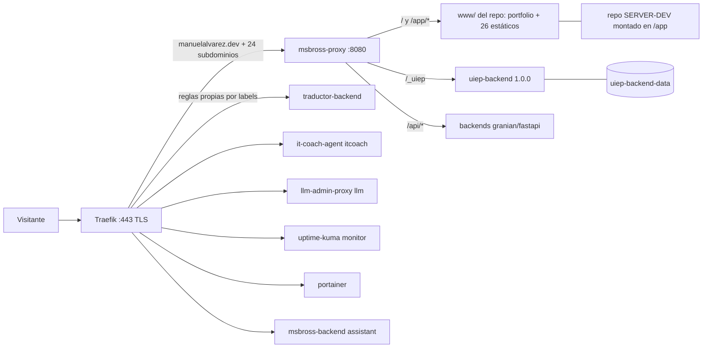

# MISIÓN 01 — Auditoría de arquitectura y despliegue de manuelalvarez.dev

Fecha: 31-oct-2026 · **Solo lectura** (ningún contenedor, imagen, volumen, DNS, proxy,
repo ni aplicación modificados) · Referencia de partida: main `44431f5` · UIEP 1.0.0
congelada (tag `uiep-1.0.0`, imagen `4ea095d6f29a`).

---

## 1. Resumen ejecutivo

- `manuelalvarez.dev` sirve el **portfolio** (build React de `apps/msbross-frontend`,
  commiteado en `www/index.html` + `www/assets/`) servido por el contenedor
  **msbross-proxy** (el repo entero está montado en el contenedor). El nginx del host
  está **inactivo**; el directorio `/var/www/manuelalvarez` es **legado** de la era
  nginx (no sirve tráfico).
- Existe un **portfolio alternativo en GitHub Pages**
  (`manu-alvarez.github.io`) con un título/versión DIFERENTE al del VPS — dos
  versiones independientes de la presentación personal.
- De los **10 proyectos seleccionados**: 6 están desplegados en el VPS, 4 tienen
  GitHub Pages activa, 2 están DUPLICADOS (VPS + Pages), 1 (FoZ SoundPro) está SOLO
  en Pages y 1 (**Teringo MailOps AI**) **no se ha encontrado** en GitHub, en el VPS
  ni en el repo — punto abierto para el propietario.
- El proxy es el **punto único de fallo** de todo el portfolio y las apps estáticas.

## 2. Arquitectura real del VPS

Ya documentada con detalle en `docs/VPS-INVENTARIO.md` (sistema, firewall, docker,
almacenamiento contabilizado, seguridad). Resumen operativo:

| Plano | Componentes |
|---|---|
| Perímetro | Traefik (:80/:443, TLS Let's Encrypt `/opt/traefik/acme.json`) |
| Enrutado | msbross-proxy (Express, node:22-alpine) — monta el repo `/home/ubuntu/MSBrossAI → /app` |
| Apps | 25 contenedores (uiep, hub API, nikolina×3, jartosdto×4, cuentos×3, elitescout×2, iaprod, traductor, gas-station, industrialpro, atenea, it-english, llm-admin-proxy, portainer, uptime-kuma) |
| Host | Ollama (systemd, modelos en `/usr/share/ollama` 15G), PM2 (livekit-server), swap 8G, tailscale, fail2ban+AIDE |

## 3. Diagrama de infraestructura y flujo de peticiones

## 4. Mapa de dominios, subdominios y rutas

| Host | Sirve | Mecanismo |
|---|---|---|
| `manuelalvarez.dev` | **Portfolio** (msbross-frontend build en `www/`) | proxy (router `msbross-proxy-root`) |
| `uiep` | UIEP 1.0 (SPA + API `/_uiep`) | proxy (DOMAIN_APP_MAP) |
| `maya` | Tu Energía Maya (estático `www/app/maya`) | proxy |
| `logisearch` / `logitrack` | LogiSearch / LogiTrack (estáticos) | proxy |
| `nikolina` | Nikolina AI (estático + LiveKit) | proxy + PM2 livekit (:7880/:7881) |
| `combipro`, `gasstation`, `cuentos`, `tarot` | CombiPro / GasStation / Cuentos / Tarot RWS+Maya (estáticos) | proxy |
| `itcoach` | it-coach-agent (backend) | **router directo por labels** |
| `traductor`, `assistant`, `llm`, `monitor`, `portainer`, `traefik` | backends/herramientas | directo por labels |
| No presentes en el VPS | **FoZ SoundPro** (solo Pages) · **Teringo MailOps AI** (no encontrado) | — |

## 5. Inventario individual (los diez proyectos seleccionados)

| # | Proyecto | Repositorio | VPS | Acceso VPS | GH Pages | Estado |
|---|---|---|---|---|---|---|
| 1 | **UIEP** | monorepo `apps/uiep` (GitHub `SERVER-DEV`, main `44431f5+`) | ✅ docker `uiep-backend:1.0.0` | `uiep.manuelalvarez.dev` + `/app/uiep` + API `/_uiep` | No aplica (backend) | **Activo** (congelado, backups+restore verificados) |
| 2 | **Tu Energía Maya** | `manu-alvarez/TuEnergiaMaya` (repo separado) | ✅ estático `www/app/maya` | `maya.manuelalvarez.dev` | ✅ `gh-pages` **built** → `manu-alvarez.github.io/TuEnergiaMaya` | **Activo + duplicado** (VPS y Pages; versión no comparada en detalle) |
| 3 | **LogiSearch** | `manu-alvarez/LogiSearch` + monorepo `apps/logisearch` | ✅ estático `www/app/logisearch` | `logisearch.manuelalvarez.dev` (+alias `logitrack`) | ❌ sin Pages | **Activo** (VPS) — backend no identificado como contenedor propio |
| 4 | **Nikolina AI** | monorepo `apps/livekit-nikolina` | ✅ 3 contenedores + PM2 livekit | `nikolina.manuelalvarez.dev` | ❌ | **Activo** (necesita backend obligatorio) |
| 5 | **FoZ SoundPro** | `manu-alvarez/FoZ-SoundPro` | ❌ (ni estático ni contenedor ni host) | — | ✅ `main` → **URL viva** (`…/FoZ-SoundPro/`, "Beatmaker AI Studio v1.2") | **Solo Pages** |
| 6 | **Teringo MailOps AI** | **NO ENCONTRADO** (ni repo GH, ni VPS, ni repo local) | ❌ | — | — | **Desconocido** — punto abierto |
| 7 | **CombiPro** | `manu-alvarez/CombiPro` + monorepo `apps/combipro` | ✅ estático `www/app/combipro` | `combipro.manuelalvarez.dev` | ❌ sin Pages | **Activo** (VPS) |
| 8 | **Cuentos Mágicos** | monorepo `apps/cuentos-magicos` | ✅ backend + celery + postgres + estático | `cuentos.manuelalvarez.dev` | ❌ | **Activo** (app completa con backend) |
| 9 | **GasStation** | monorepo `apps/gas-station` | ✅ backend + estático | `gasstation.manuelalvarez.dev` | ❌ | **Activo** (con backend) |
| 10 | **Tarot RWS** | `manu-alvarez/tarot-rws` | ✅ estático `www/app/tarot-rws` | `tarot.manuelalvarez.dev` | ✅ `main` **built** | **Activo + duplicado** (VPS y Pages) |

Otros despliegues no seleccionados (históricos/otros negocios): iaprod-os, industrialpro,
traductor-pro, it-english-coach, atenea, edelweiss, cv, taskflow, moko-tools, logitrack,
app-generator, assistant, msbross, dev-dashboard, admin-dashboard, uiep-web (estático
dormido), mapa de `/var/www/manuelalvarez` (legado) — **sin tocar**.

## 6. Relación GitHub / GH Pages / VPS

| Patrón | Proyectos | Observación |
|---|---|---|
| Solo VPS (backend necesario) | UIEP, Nikolina, Cuentos, GasStation | las Pages no pueden sustituirlos (backend/persistencia) |
| Solo VPS (estático, sin Pages) | CombiPro, LogiSearch | el VPS es la ÚNICA versión pública |
| Solo Pages | **FoZ SoundPro** | no requiere backend (studio estático) |
| Duplicado VPS + Pages | **Tu Energía Maya, Tarot RWS** | dos despliegues independientes del mismo proyecto; versiones no comparadas a nivel de build |
| Portfolio en dos sitios | `manuelalvarez.dev` (VPS) vs `manu-alvarez.github.io` | **versiones DIFERENTES** (títulos distintos; la de GH Pages parece anterior) |

## 7. Arquitectura actual del portfolio

- Build de `apps/msbross-frontend` commiteado en `www/index.html` + `www/assets/` del
  monorepo → servido por msbross-proxy (el repo montado en el contenedor).
- Actualización: `scripts/build/sync_www.sh` (copia builds al www/) + commit + en el
  VPS `scripts/deploy/vps_deploy.sh` (git reset + compose). El workflow GH
  `deploy.yml` (rsync) está **desactivado** (workflow_dispatch).
- La presentación de proyectos y el enlazado de apps viven EN el build del frontend
  (un solo sitio estático monolítico).
- Separación portfolio/apps: MISMO dominio raíz; las apps en subdominios y rutas
  `/app/*` — separación razonable, pero gestionada a mano en dos lugares (README de
  apps + proxy NEXT_APPS/DOMAIN_APP_MAP).

## 8. Duplicidades, inconsistencias y dependencias

1. **Portfolio doble** (VPS vs github.io) con versiones distintas — inconsistencia de
   marca/contenido.
2. Tu Energía Maya y Tarot RWS con **dos despliegues vivos** cada uno — riesgo de
   divergencia de versiones (no comparadas en profundidad: builds con assets hashados).
3. `www/app/uiep-web` estático DORMIDO (versión previa de UIEP) — no confundir con la
   activa.
4. `logitrack` existe como estático propio Y como "alias de LogiSearch" en el README —
   aclarar identidad.
5. `maya` vs `tarot-maya` vs repo `Tarot-Maya`: tres piezas maya relacionadas (Tu
   Energía Maya = `maya`; Tarot Maya = proyecto distinto no seleccionado).
6. Deps del portfolio: Google Fonts (CDN externo) — única dependencia externa
   detectada en el HTML raíz.

## 9. Riesgos operativos y puntos únicos de fallo

| Riesgo | Impacto | Mitigación existente |
|---|---|---|
| **msbross-proxy caído** | cae el portfolio + TODAS las apps estáticas + UIEP | git+rebuild; sin réplica |
| **Traefik caído** | cae TODO el perímetro | reinicio por docker (restart policy) |
| Disco lleno (ocurrió) | builds fallan; contenedores pueden morir | 50% libre + runbook; **vigilar** |
| Sin copia externa de Postgres/MinIO de otros proyectos | pérdida de datos en pérdida total del VPS | pendiente de decisión (UIEP ya tiene copia externa vía iCloud) |
| Contenido del portfolio en 2 sitios | visitante con versión desactualizada | decisión pendiente (única fuente de verdad) |
| Teringo desconocido | el portfolio podría enlazar a algo inexistente | aclarar con el propietario |

## 10. Información NO verificada (limitaciones)

- **Teringo MailOps AI**: inexistente en GitHub (búsqueda), VPS (imágenes/estáticos/
  hosts) y repo local. Puede estar en otra cuenta/proveedor u otro nombre.
- Versiones EXACTAS de los duplicados VPS↔Pages (requeriría descargar y diff de
  builds hasheados; solo se compararon títulos).
- El estado real de las DEMOS de repos sin Pages (LogiSearch/CombiPro en GitHub solo
  código).
- `/var/www/manuelalvarez`: contenido legado sin verificación de si algo externo
  (cache DNS, enlaces antiguos) aún lo referencia.
- Configuración dinámica de Traefik: routers por labels inventariados; no se revisó
  el acme.json (contiene datos sensibles).

## 10b. MISIÓN 02 — hallazgos de trazabilidad profunda (solo lectura)

### Teringo MailOps AI / Teringo CockPit — veredicto

Fuentes inspeccionadas (todas de lectura): árbol completo del VPS (`find` por
teringo/cockpit/mailops en /home, /var/www, /opt, /srv, /root), imágenes y
contenedores docker, ramas y tags git del monorepo, historial completo de commits
(grep case-insensitive), PM2, n8n (no existe en el servidor), buckets MinIO, repos de
GitHub del usuario (45 repos, búsqueda global incluida).

**Resultado**: la ÚNICA traza de Teringo en toda la infraestructura es
`/home/ubuntu/.cloudflared/teringo.json` — una **credencial de túnel Cloudflare sin
usar** (tunnel ID `c4530897-…`, creada 12-may, **el túnel no está configurado en
ningún `config.yml` ni en ejecución**). No hay código, no hay contenedor, no hay
estático, no hay historial git, no hay repositorio. **El proyecto Teringo no existe en
este servidor**; o se desarrolló en otro sitio, o nunca llegó a existir más allá del
túnel. El componente `ArchitectCockpit.tsx` del portfolio es el héroe 3D de la landing
— no guarda relación con un producto MailOps.

⚠️ **Seguridad**: durante la investigación se imprimió por error el `TunnelSecret` del
túnel teringo.json en el registro de sesión de esta conversación. **Rotación
recomendada**: eliminar/recrear el túnel desde el dashboard de Cloudflare (decisión del
propietario; el túnel está inactivo).

### Hallazgo colateral: msbross.me caído

El `config.yml` de cloudflared activo enruta `msbross.me` y `*.msbross.me` →
`localhost:8080` (msbross-proxy), pero **cloudflared no se ejecuta** (sin proceso, sin
servicio systemd, sin unit file). El dominio `msbross.me` está actualmente **offline**
(aunque su DNS de Cloudflare siga apuntando al túnel). Decisión pendiente: reactivar
el túnel (si msbross.me sigue siendo relevante) o retirarlo de la arquitectura.

### Git del monorepo: divergencia main/master

- `main` = línea actual (Fases UIEP 0→9 + docs del ecosistema).
- `master` = línea LEGADA (último commit `13a5744` "Fase 2 audit, security sweep,
  legacy cleanup" — la era pre-UIEP con CI por rsync).
- Existe rama remota de seguridad `backup/vps-divergencia-20261030` (copia de la
  divergencia del 30-oct) y tag `backup-pre-limpieza`.
- Ambas líneas conviven; la Documentación/runbook referencia SIEMPRE `main`. No se
  toca nada (solo trazabilidad registrada).

### Procedencia de los estáticos de los repos separados

`www/app/maya` y `www/app/tarot-rws` (y las páginas de FoZ) NO tienen código fuente en
el monorepo: son **artefactos compilados** copiados desde sus repositorios separados
(`TuEnergiaMaya`, `tarot-rws`, `FoZ-SoundPro`). El flujo real es: build en el repo
origen → copia manual/script a `www/app/<nombre>/` → commit en el monorepo → deploy
VPS. `scripts/build/sync_www.sh` automatiza la copia de los builds de apps DEL
monorepo (no de los repos externos). **Riesgo trazable**: sin registro de qué commit
del repo origen generó cada artefacto (trazabilidad de versión débil en los
duplicados).

## 11. Conclusiones y cuestiones que requieren decisión

1. **¿Portfolio único?** Elegir la fuente de verdad (`manuelalvarez.dev` VPS
   recomendado por ser el más actual) y retirar/redirigir `manu-alvarez.github.io`.
2. **¿Duplicados VPS+Pages?** Para Tu Energía Maya y Tarot RWS: decidir por proyecto
   si Pages es demo y VPS la versión principal (hoy ambas viven sin gobierno).
3. **Teringo MailOps AI**: dónde está realmente (¿otra cuenta, otro proveedor, nombre
   distinto?) — sin esto no puede entrar en el portfolio.
4. **FoZ SoundPro**: ¿se incorpora al VPS (estático, sin backend) o queda como demo en
   Pages? Ambas son viables; hoy solo existe Pages.
5. **El portfolio raíz** incluye/estructura los proyectos por build manual — si se
   consolidan selecciones, conviene extraer la lista de proyectos a datos (JSON) para
   que el portfolio y la documentación compartan fuente única.

**No se ha modificado nada** (contenedores, imágenes, volúmenes, DNS, proxy, repos,
Pages, workflows). Todas las comprobaciones fueron de lectura; las limitaciones quedan
documentadas en §10.
