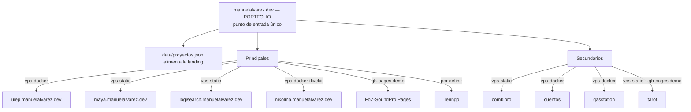

# Arquitectura OBJETIVO del portfolio manuelalvarez.dev (Misión 02)

Diseño propuesto tras la auditoría (`PORTFOLIO-ARQUITECTURA-ACTUAL.md`). **No se ejecuta
nada** hasta revisión y aprobación: este documento define el QUÉ y el CÓMO; el plan por
etapas (§10) marca el CUÁNDO.

## 1. Principios de la arquitectura objetivo

1. **manuelalvarez.dev = punto de entrada único y coherente**: presentación profesional
   uniforme, enlaces claros, experiencia consistente — INDEPENDIENTEMENTE de dónde se
   ejecute cada proyecto (VPS, Pages o externo).
2. **Cada proyecto usa el mecanismo que su arquitectura exige**: estático, contenedor,
   backend+persistencia, procesos persistentes.
3. **GitHub = control de versiones** (monorepo SERVER-DEV + repos independientes).
   **GH Pages = despliegues EXISTENTES conservados intactos** (demo/estáticos de otros
   desarrollos); sin eliminaciones, sobrescrituras ni redirecciones.
4. **Fuente única de verdad del catálogo de proyectos** (datos compartidos entre el
   portfolio y la documentación) — fin de las listas duplicadas a mano.
5. Cero coste adicional; infraestructura actual aprovechada (no migrar tecnologías).

## 2. Estructura de directorios recomendada (evolutiva, sin big-bang)

```
SERVER-DEV/
├── apps/<proyecto>/          # código fuente (proyectos del monorepo) — IGUAL QUE HOY
├── www/
│   ├── index.html + assets/  # portfolio (build de msbross-frontend) — IGUAL
│   └── app/<slug>/           # artefactos estáticos publicados — IGUAL
├── infrastructure/
│   ├── msbross-proxy/        # proxy central — IGUAL
│   ├── docker-compose.yml    # servicios — IGUAL
│   └── backup/               # backups UIEP + pull externo — IGUAL
├── data/
│   └── proyectos.json        # ★ NUEVO: catálogo único de proyectos (fuente para
│                             #    portfolio + docs): nombre, tipo, dominio, repo,
│                             #    modo (vps-static|vps-docker|gh-pages|externo),
│                             #    estado, GH Pages URL
├── templates/                # (uiep) blueprints — IGUAL
├── docs/
│   ├── VPS-INVENTARIO.md · RUNBOOK.md · PORTFOLIO-ARQUITECTURA-*.md
│   └── proyectos/<slug>.md   # ★ NUEVO: ficha técnica por proyecto (gradual)
└── scripts/{build,deploy,ops}/  # automatizaciones — IGUAL (+proyectos.json check)
```

**Correspondencia actual→objetivo**: la estructura NO cambia (aprovechar lo existente);
se AÑADEN: `data/proyectos.json` (catálogo único) + `docs/proyectos/` (fichas
graduales, empezando por los 10 seleccionados). Convención de nombres: el slug del
catálogo = dominio = directorio www = nombre de contenedor cuando aplique (hoy ya se
cumple salvo maya→TuEnergiaMaya y tarot→tarot-rws — documentados en el catálogo, sin
renombrar nada).

## 3. Mapa de dominios y rutas (objetivo — sin cambios de dominios)



Regla del proxy SIN CAMBIOS (msbross-proxy-root ya enruta los 25 hosts). Teringo: sin
destino definido hasta aclarar dónde vive (§10).

## 4. Distribución de los diez proyectos (mecanismo por arquitectura real)

| Proyecto | Mecanismo objetivo | Cambio respecto a hoy |
|---|---|---|
| UIEP | vps-docker (1.0.0 congelada) | ninguno |
| Tu Energía Maya | vps-static (`maya`) + **gh-pages conservada** | ninguno; añadir trazabilidad de versión del repo origen |
| LogiSearch | vps-static | ninguno; aclarar si tiene backend (hoy llama a APIs — verificar en su ficha) |
| Nikolina AI | vps-docker + PM2 LiveKit | ninguno |
| FoZ SoundPro | **gh-pages** (sin backend; v1.2 viva) | ninguno (opción futura: estático en VPS si se quiere en dominio propio) |
| Teringo MailOps AI / CockPit | **por definir** (no localizado) | bloqueado hasta aclarar origen |
| CombiPro | vps-static | ninguno (opción futura: Pages si se quiere demo pública) |
| Cuentos Mágicos | vps-docker + estático | ninguno |
| GasStation | vps-docker + estático | ninguno |
| Tarot RWS | vps-static + **gh-pages conservada** | ninguno; trazabilidad de versión |

**Conclusión clave**: los diez proyectos YA viven en la arquitectura correcta para su
naturaleza — el objetivo no es migrar sino ORDENAR, TRAZAR y ASEGURAR (catálogo único,
fichas, backups externos, política de Pages).

## 5. Servicios compartidos y específicos

| Compartido | Quién lo usa | Riesgo PUF | Mitigación objetivo |
|---|---|---|---|
| Traefik | todo | sí | restart policy + uptime-kuma ya monitoriza; añadir alerta |
| msbross-proxy | portfolio + estáticos + UIEP | **sí (crítico)** | health check + restart + (opción futura: réplica) |
| Ollama (host) | UIEP (agentes+embeddings) | sí para UIEP | swap + límites (F8) |
| Postgres/Redis/MinIO por proyecto | cuentos/jartosdto/elitescout | por proyecto | backups por proyecto (pendiente decisión) |
| LiveKit (PM2 host) | nikolina | sí | restart pm2 + documentado |

## 6. Dependencias y persistencia (por proyecto — resumen)

| Proyecto | Persistencia | Integraciones externas |
|---|---|---|
| UIEP | volumen docker (specs/knowledge/runs/memory/audit) + backup diario + copia iCloud | Ollama local; MCP self; httpbin (demo) |
| Nikolina | LiveKit (PM2) + configs en repo | telefonía/LiveKit cloud |
| Cuentos | postgres volume + storage dir | — |
| JartosDTO (no seleccionado pero compartido) | pgvector + redis + minio | — |
| maya / tarot-rws / combipro / logisearch / foz | sin backend: build estático | APIs externas por JS cliente (logisearch) |
| El resto | sin estado relevante | — |

## 7. Modelo de despliegue y actualización (objetivo)

1. **Portfolio**: `apps/msbross-frontend` → build → `sync_www.sh` → commit → VPS
   `git reset --hard` (el proxy sirve al instante). Rollback: `git revert`/checkout.
2. **Estáticos de repos externos** (maya/tarot-rws/foz): build en el repo origen →
   copiar a `www/app/<slug>/` → commit monorepo. ★ Mejora: registrar en el commit la
   versión/commit de origen (una línea en `www/app/<slug>/BUILD-INFO.json`) —
   trazabilidad de versión para los duplicados.
3. **Backends docker**: build imagen → compose up (patrón runbook) con verificación de
   binario servido.
4. **Gate de calidad**: los tests + RAG gate (UIEP) antes de cada build de imagen.
5. **Nada se despliega automáticamente por push** (los workflows GH de deploy están
   desactivados por diseño; el despliegue es SSH consciente).

## 8. Política de GitHub y GH Pages (conservación)

- **Intocables**: repos, ramas gh-pages, Actions, configuraciones Pages, dominios
  custom, URLs públicas de: TuEnergiaMaya, tarot-rws, FoZ-SoundPro, Tarot-Maya,
  manu-alvarez.github.io (y las de otros desarrollos).
- Los proyectos con Pages + VPS (maya, tarot-rws) mantienen AMBAS modalidades: Pages =
  demo pública independiente; VPS = instancia del portfolio (dominio propio). Para
  evitar divergencias no controladas: cada deploy VPS de un proyecto duplicado anota
  la versión de origen en BUILD-INFO.json (§7.2).
- El portfolio (manuelalvarez.dev) enlazará las URLs que el catálogo declare
  (`data/proyectos.json` decide por proyecto: dominio VPS, URL Pages o externo).
- `manu-alvarez.github.io` (portfolio alternativo, versión antigua): NO se toca en esta
  fase; decisión futura (conservar como demo/retirar del enlazado) — nunca eliminación.

## 9. Backups y recuperación

| Elemento | Estrategia |
|---|---|
| UIEP datos | diario 04:17 VPS + **copia externa iCloud** (pull script) ✓ |
| Contratos/HTML del ecosistema | GitHub (externo por diseño) |
| Postgres/MinIO de los otros proyectos | **pendiente de decisión** (pg_dump → destino externo) — propuesta: mismo patrón pull-to-Mac cuando el propietario lo apruebe |
| Configs (.env) | gestor de contraseñas del propietario (fuera del VPS) |
| Restore | runbook (aislado + verificación de counts) — verificado en v1.0 |

## 10. Riesgos, decisiones pendientes y prioridades

**Riesgos** (heredados de la auditoría + nuevos): msbross-proxy PUF · disco (50%,
vigilar) · divergencia de versiones en duplicados sin BUILD-INFO · msbross.me offline
(túnel parado) · secret de túnel teringo expuesto en conversación (rotar el túnel).

**Decisiones pendientes del propietario**:
1. ¿Dónde está Teringo MailOps AI / CockPit? (bloquea su incorporación al portfolio)
2. ¿Destino del portfolio duplicado en github.io? (conservar como demo / retirar del
   enlazado / actualizarlo)
3. ¿Copia externa de los Postgres de otros proyectos? (mismo patrón que UIEP)
4. ¿msbross.me se mantiene (reactivar túnel) o se retira del mapa?
5. Aprobación de las ETAPAS de abajo.

## 11. Plan de ejecución por etapas (propuesta — NO ejecutada)

| Etapa | Alcance | Dependencias | Riesgo | Impacto producción | Rollback | Criterio de aceptación |
|---|---|---|---|---|---|---|
| **0. Decisiones** | Aprobar arquitectura + responder las 5 decisiones pendientes | — | — | ninguno | — | sign-off del propietario |
| **1. Preparación** | `data/proyectos.json` (catálogo de los 10) + `docs/proyectos/` (10 fichas) + BUILD-INFO.json en futuros despliegues | Etapa 0 | nulo (solo repo) | ninguno | git revert | catálogo alimenta el portfolio |
| **2. Organización** | Rotular/clasificar (sin mover): marcar históricos en el catálogo; alinear NEXT_APPS/DOMAIN_APP_MAP del proxy con el catálogo | Etapa 1 | bajo (toque del proxy → prueba de todos los dominios) | el proxy se recarga (ventana <1 min) | git revert + restart proxy | 25 hosts responden igual que antes |
| **3. Despliegues que faltan** | FoZ: opcional estático en VPS (decisión); Teringo: cuando exista | Etapa 0/1 | medio (nuevos despliegues) | añadidos nuevos | borrar del catálogo + proxy | los 10 en el catálogo con su modo |
| **4. Integración portfolio** | La landing lee `data/proyectos.json` (build-time o fetch) — fuente única portfolio↔docs | Etapa 1 | medio (toque del build del portfolio) | redeploy del portfolio | git revert + redeploy | portfolio muestra la selección de 10 con enlaces correctos |
| **5. Validación operativa** | Pruebas de todos los dominios + backups + observabilidad + docs consolidadas | 1-4 | nulo | ninguno | — | checklist verde en runbook |

---

**Estado**: propuesta de diseño — NADA ejecutado. Espera revisión del propietario
(especialmente las 5 decisiones de §10) antes de la Etapa 1.
