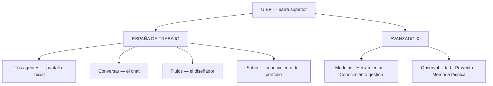

# UIEP 1.1 — Propuesta de Usabilidad (Misión 06 — SOLO PROPUESTA, sin implementar)

Diagnóstico y propuesta funcional para que alguien SIN conocimientos de arquitectura
agéntica pueda usar UIEP. **No se modifica producción** (1.0.0/1.0.1 congeladas); esta
propuesta espera aprobación para convertirse en la Fase de UX de una futura 1.1.

## 1. Diagnóstico (problemas comunicados → causa en el diseño actual)

| Problema | Causa de diseño |
|---|---|
| Menú lateral técnico | 11 entradas planas con vocabulario interno (Workflows, Integraciones, Observabilidad, Proyecto…) |
| Pantalla inicial de métricas | El Dashboard expone el estado OPERATIVO del servidor, no QUÉ PUEDE HACER el usuario |
| Crear/usar agentes no es evidente | El flujo real (crear agente → darle conocimiento → probarlo → guardarlo) está repartido en 4 páginas sin guía |
| UUIDs y nombres técnicos | `ses-9d2c8cfab17f`, `kn-mvwe3u01-d5hu5o`, `wfr-…` expuestos como identidad principal |
| Relación entre piezas invisible | Agentes/Modelos/Herramientas/Conocimiento/Memoria/Workflows son islas: no se ve QUÉ agente usa QUÉ |

## 2. Navegación propuesta (dos espacios)



- **Espacio de TRABAJO** (lo que la gente viene a hacer): *Tus agentes*, *Conversar*,
  *Flujos*, *Saber*.
- **AVANZADO** (plegado, segunda zona del menú): Modelos, Herramientas, Conocimiento
  (gestión), Memoria, Observabilidad, Proyecto.
- El menú deja de ser 11 términos técnicos → 4 tareas + 6 administrativas plegadas.

## 3. Pantalla inicial orientada a tareas (wireframe textual)

```
┌──────────────────────────────────────────────────────────────┐
│  UIEP                                    [AVANZADO ⚙️] Salir │
├──────────────────────────────────────────────────────────────┤
│                                                              │
│   Hola, Manuel. ¿Qué quieres crear hoy?                      │
│                                                              │
│   ┌─────────────────┐  ┌─────────────────┐                   │
│   │ 🤖 Crear un     │  │ 💬 Hablar con   │                   │
│   │    agente       │  │    un agente    │                   │
│   └─────────────────┘  └─────────────────┘                   │
│   ┌─────────────────┐  ┌─────────────────┐                   │
│   │ 🔀 Diseñar un   │  │ 📄 Enseñar algo │                   │
│   │    flujo        │  │    a un agente  │                   │
│   └─────────────────┘  └─────────────────┘                   │
│                                                              │
│   TUS AGENTES (recientes)                                    │
│   ● Nikolina Host   — atiende reservas        [Conversar]    │
│   ● Analista RAG    — busca en tus docs       [Conversar]    │
│   + Crear nuevo…                                             │
│                                                              │
│   [estado del sistema: ✓ todo operativo (detalle en AVANZADO)]│
└──────────────────────────────────────────────────────────────┘
```

- El panel operativo actual (métricas, runs, servicios) se muda a **AVANZADO →
  Observabilidad** intacto.
- "Tus agentes" lista NOMBRES EDITABLES con descripción humana (ver §5).

## 4. Flujo guiado de creación de agentes (el recorrido completo)

Asistente en 4 pasos con vista previa permanente del AgentSpec:

```
PASO 1 ¿Quién es?      → nombre visible ("Nikolina Host"), descripción,
                         rol y objetivo (texto libre con ejemplos)
PASO 2 ¿Qué sabe hacer? → instrucciones + elegir modelo (tarjeta con
                         el estado real: ✓ disponible)
PASO 3 ¿Con qué recursos? → toggle de herramientas + fuentes de
                          conocimiento (checkboxes de sus documentos)
PASO 4 Probar ahora     → mini-playground embebido; si convence →
                         [Guardar agente] (spec validado en el backend)
```

Después: la ficha del agente (tarjeta con: nombre/descripción, modelo, recursos,
[Conversar] [Editar] [Clonar] [Versiones]) — los UUID solo en el detalle técnico.

## 5. Nombres visibles vs identificadores internos

- Los AgentSpecs ya tienen `metadata.name` (editable) — se ELEVA a identidad
  principal en TODA la UI (listas, sesiones, runs, workflows).
- Las sesiones/runs/workflows ganan un **alias humano** (fecha + intención, p. ej.
  "Conversación 31-oct 12:30 — reservas") con el UUID visible solo en el inspector.
- El catálogo `data/proyectos.json` ya aplica el patrón (nombre humano + slug).

## 6. Relación visible entre piezas (lo que hoy es invisible)

- En la ficha de cada agente: sus recursos REALES (modelo, tools autorizadas, fuentes
  de conocimiento vinculadas, memorias) — los datos existen (bindings, spec.tools).
- En cada run/conversación: los fragmentos de conocimiento citados [n] (ya existe en
  RunDialog) + las memorias usadas.
- En Flujos: el diseñador visual ya muestra el grafo — añadir el estado en vivo por
  nodo durante la ejecución (ya existe en el inspector → integrarlo en el canvas).

## 7. Plan de implementación (cuando se apruebe)

| Etapa | Alcance | Sin romper |
|---|---|---|
| 1 | Navegación 2 espacios + home de tareas (los paneles actuales se recolocan, nada se pierde) | contratos/API intactos |
| 2 | Nombres humanos + ficha de agente con recursos + alias de sesiones | UUIDs internos intactos |
| 3 | Asistente guiado de creación (usa el mismo POST /api/specs validado) | el editor JSON/estructurado sigue disponible |
| 4 | Integración conocimiento/memoria en la ficha + mini-playground embebido | las APIs ya existen |
| 5 | Flujos: estado en vivo en el canvas | inspector actual como fallback |

Riesgo: bajo (todo es capa de presentación sobre APIs existentes; el GATE y los
contratos no cambian). Rollback: git.

## 8. Wireframe del panel de agente (ficha con recursos)

```
┌─ Nikolina Host ──────────────────────────────── [Conversar] ┐
│ Atiende reservas del restaurante y responde por voz.        │
│ ───────────────────────────────────────────────────────────  │
│ MODELO      ✓ qwen3.5:4b (disponible)                       │
│ HERRAMIENTAS ✓ clock   ✓ memory-write                       │
│ SABE DE     📄 Carta del restaurante · 📄 Horarios          │
│ MEMORIA     3 recuerdos activos (ver)                       │
│ ───────────────────────────────────────────────────────────  │
│ [Editar] [Clonar] [Versiones (3)]           id: nikolina-…  │
└──────────────────────────────────────────────────────────────┘
```
